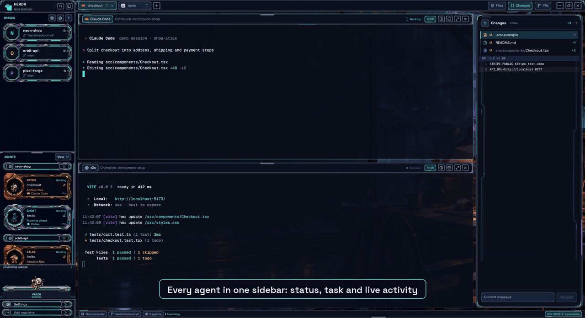

# Neon Borough for herdr

A cyberpunk layout for [herdr](https://herdr.dev): neon panels, a robot crew for your agents, a town for your spaces, and panels for approving merges, moving files between machines and handing agents secrets they never see.



[Full-resolution video (MP4)](demo.mp4) · [Still screenshot](preview.png)

The demo is a staged session: the projects and agents in it are scripted, not real work.

## Install

1. Copy `layouts/`, `mods/` and `themes/` from this repo into `~/.config/herdr-app/` (nothing here replaces herdr's own files).
2. Check the mods and switch to the layout:

   ```sh
   cd ~/.config/herdr-app
   for m in mods/*/; do herdr-app check "$m"; done
   herdr-app do layout.switch --name neon-borough
   ```

   `Ctrl+Shift+L` switches between layouts; `Ctrl+Alt+Shift+Escape` always returns to herdr's default.

## Optional: approvals, scheduled merges and secrets

These use `herdr-pr`, a small Python CLI shipped in `mods/pr-hub/herdr-pr`.

- Open the PR panel, click the gear, and under **Scheduled merges** click **Set up** on each machine that should run merges. It installs `~/.local/bin/herdr-pr` there and a one-minute timer (cron, or Task Scheduler on Windows).
- Needs Python 3 and the GitHub CLI (`gh auth login`) on those machines; file transfer needs ssh keys to your remote machines.
- Tell your agents about it, for example in `CLAUDE.md` / `AGENTS.md`:

  ```text
  Don't merge PRs yourself. Ask: herdr-pr ask <pr> --risk low|medium|high|critical --area <areas> --testing "1. ..." --wait
  For secrets, never ask me to paste them: herdr-pr secret <path/.env> <KEY> --note "why" --wait
  Every PR description gets a Manual testing section where a person can check the change.
  ```

## Optional: usage & accounts

The usage panel (gauge in the status bar) shows plan limits, tokens and the signed-in account for Codex and Claude Code, and opens a sign-in tab to switch accounts. It never reads your credentials. Codex needs only the `codex` CLI on `PATH`. For Claude Code run this once, after the mods are installed. It backs up `~/.claude/settings.json`, then adds a status-line command and a SessionStart hook; a status line you already had keeps running:

```sh
python ~/.config/herdr-app/mods/neon-usage/install-usage-monitor.py
```

## What's inside

See [RECIPE.md](RECIPE.md) for the full description: every region, behaviour, mod and known limit.

## Credits

- Art: original, generated with ChatGPT image generation and directed by the author. See [ART.md](ART.md).
- `mods/pr-hub` is built on pr-flow by jjangsky (MIT, `mods/pr-hub/LICENSE.pr-flow`).
- Space Grotesk font (SIL OFL 1.1, `mods/neon-chrome/fonts/OFL.txt`); Pixelarticons (`mods/my-spaces/icons/pixelart/LICENSE`).
- The header uses herdr's logo, recolored, to mark this as a herdr layout.
