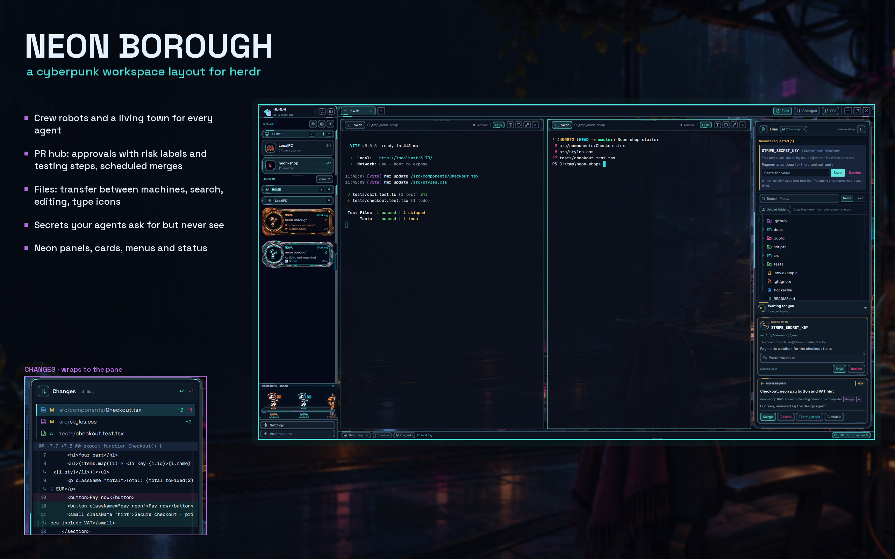

# Neon Borough

A cyberpunk workspace for herdr: gunmetal panels with cyan and violet neon over a rain-soaked rooftop workshop, a robot crew that acts out what each agent is doing, a town of houses for your spaces, and working panels for the jobs around coding agents: approving and scheduling PR merges, moving files between machines, editing configs, and handing agents secrets they never see. It is one layout, `neon-borough`, built from 17 mods.

## What you see

Left to right, top to bottom (sizes at zoom 1):

- **Sidebar**, 252 px (44 to 480, drag its edge; under 160 px the mods draw a compact rail). Background `mods/my-spaces/art/sidebar-neon.png` (cover), straight cyan/violet neon tubes.
  - **Brand**, 46 px: the herdr logo recolored cyan/violet, "HERDR / NEON BOROUGH", search and sidebar buttons in square gunmetal keycaps.
  - **Spaces** (weight 0.7): machines as framed group headers (alias, count, +, fold chevron), spaces as illustrated cards: house emblem or pixel icon, name, folder or branch, worktrees as inset child cards on a connecting rail.
  - **Agents** (weight 1.3): illustrated crew cards per agent: robot portrait in a provider frame (Claude orange, Codex blue, others neutral), robot name, chat name with a rename pencil, live activity line, provider, age. A View menu sorts and filters.
  - **Companion hangar**, 126 px: the robots of the active tab standing on a lit deck with name and status strips.
  - **Footer**, 69 px: Settings and Add machine.
- **Work column**:
  - **Tab bar**, 42 px: tabs as bevelled pills, +, then Files, Changes and PRs toggles on the right and window buttons (the layout draws its own title bar).
  - **Work body**, padding 8, gap 8:
    - **Terminals** over `crew/art/rooftop-workshop.png` (cover), terminal opacity 0.65, padding 16. Panes are square cards (`#080d1628`, 1 px border, accent when focused, gap 12) with a 38 px metal header rail: program nameplate, folder, status, FX switch, split / zoom / close keycaps.
    - **Side panel**, 368 px (280 to 900), hidden until a toggle opens it; a stack of Files, Changes and Pull requests, each inside a framed panel (fixed corner fittings, flexible rails, cyan and violet accent lights).
    - **Waiting for you**: a floating box at the bottom right, shown only while an agent waits for a merge approval or a secret.
  - **Status strip**, 28 px: machine, branch, agent counts, the command shortcut.
- **Full-window screens** (same root stack): the **town** (an adaptive panorama of houses per space, robots walking lanes, district controls, a motion toggle) and **crew cards**.

Fonts: Geist Mono for terminals, Space Grotesk for the UI (bundled in `mods/neon-chrome/fonts`). Root background `#090d18`. Palette: cyan `#49dcd7`, violet `#b46bdf`, rails `#263546` with `#718295` edges, gunmetal faces `#121e2d`.

## How it behaves

- **Agent status** drives every robot and card: *working* animates the sprite and instruments, *blocked* (needs you) holds an attention pose with a gentle amber pulse, *done* shows a steady completion pose, *idle* stays calm. The FX switch turns animation off; state stays visible through labels, colors and poses.
- **Spaces**: click selects; drag a space or a machine header to reorder; right-click a machine to rename it, a space for its icon (Pixelarticons picker) or house. Pages over the list show chosen machines only.
- **Agents**: click focuses the agent; the pencil renames its tab (explicit names beat terminal titles); right-click opens the robot's profile.
- **Town**: the robot button beside Spaces opens it across the window; clicking a resident or building returns to that agent or space; Escape or "Back to workspace" leaves.
- **Pull requests** (PRs toggle): your PRs, your agents' PRs and review requests, filtered by owner and repo, with CI, deploy runs and controls (merge, auto-merge, ready/draft, update branch, approve, comment, close/reopen, re-run, delete branch). Opening a PR shows a large reading dialog.
  - **Approvals**: an agent runs `herdr-pr ask <pr> --risk high --area design,ui --testing "1. ..." --wait`. A card appears with a risk badge and colored stripe, area chips, the note and expandable manual testing steps. Merge uses the person's own `gh`, pinned to the commit the agent asked about; high and critical need a second press. The agent's `--wait` returns merged / declined / failed.
  - **Scheduled merges**: "Schedule a merge" at a time ("tomorrow 09:00", "in 2h"); it merges only if checks pass and nothing new was pushed, waiting up to an hour for running checks. Settings lists every machine: Set up installs `herdr-pr` there and its timer (cron, or Task Scheduler on Windows), Use / Make default / Stop / Remove manage which machines run merges.
- **Files**: a lazy tree of the focused pane's folder on its machine, with type icons. Search by name or by text. Click a file to preview, Edit to change small text files (Ctrl+S; refuses when the file changed on disk). Right-click a row: Open, Download (from another machine), Download as .zip, Send to another machine's `~/inbox`, Copy path. Drop files from the desktop to upload into the folder under the pointer. A transfers drawer lists copies with errors and an Open button.
- **Secrets**: an agent runs `herdr-pr secret path/.env KEY --note why --wait`; a card with a masked input appears in Files and in Waiting for you. Save writes `KEY=value` into that file (replacing the key or appending; created if missing). The agent learns only filled or declined.
- **Changes**: changed files with type icons and +/- counts; the diff wraps long lines to the pane (continuation rows marked ↳); commit with a wrapping message box.
- **Waiting for you**: sorted secrets first, then merges by risk; a pulsing dot in the header; click the header to fold it; new high or critical asks and secrets play the attention sound.
- **Notifications** use the neon toast; menus, prompts and the rename dialog share the bevelled look.

## Built from

Layout `layouts/neon-borough.json`: root `stack` (titlebar none) of `desktop` (row: `sidebar` column of `brand` / `sidebar-lists` (`spaces`, `agents`) / `companion` / `sidebar-footer`, and `work` column of `tabs` / `work-body` (row: `main` tab block with neon-pane headers, `panel` column holding the `panel-body` stack of `files`, `changes`, `prs`) / `status`), plus `crew-screen` and `crew-cards`. `work-body` floats `inbox`. `terminal_menu` is `my-menu`. The layout's own theme is `themes/neon-borough.json`.

Mods:

| Mod | Role |
|---|---|
| `neon-chrome` | brand header and sidebar footer (clone of workspace-chrome), bundled font, control fittings |
| `my-spaces` | Spaces (clone of spaces): machine aliases, order, pages, icons, houses, worktree drawers |
| `my-agents` | Agents (clone of agents): crew cards, View menu, grouping by machine |
| `crew` | robots, companion hangar, town, crew cards, profiles; asset folders `chars/`, `town/`, `art/` |
| `my-tabs` | tab bar (clone of tabs) with Files / Changes / PRs toggles |
| `neon-pane` | pane header rail |
| `neon-status` | status strip (clone of workspace-status) |
| `neon-files` | Files: tree, icons (`types/`, `icons.js`), search, edit, transfer (`transfer.js`), zip/save/secrets (`fileops.js`) |
| `neon-changes` | Changes (clone of changes): wrapped diff, commit box |
| `pr-hub` | Pull requests (built on pr-flow, MIT), approvals, schedules (`scheduler.js`), bundles the `herdr-pr` CLI |
| `pr-summary` | the large PR reading dialog |
| `neon-inbox` | Waiting for you (floating) |
| `my-menu`, `neon-new-menu`, `neon-prompt`, `neon-rename`, `neon-toast` | menus, new-session menu, prompt, rename dialog, notifications |

herdr functions used: `spaces`, `agents`, `panes`, `terminals`, `machines`, `focused`, `exec` (with `on` for other machines), `hc`, `readTextFile`, `writeTextFile`, `watchFolder`, `pickFolder`, `shared` / `setShared`, `notify`, `playSound`, `openOverlay`, `placement`, `run` (`space.*`, `tab.*`, `pane.*`, `layout.select`, `terminal.*`). Programs run: `git`, `gh`, `scp` / `ssh`, `python` / `python3`, `sh`, PowerShell on Windows, `cron` or `schtasks`, and `herdr-pr` (shipped in `mods/pr-hub/herdr-pr`, installed to `~/.local/bin/herdr-pr` from PR Settings).

Art: original, generated with ChatGPT image generation and directed by the author; prompts are kept beside the images (`*prompts*.json`). See ART.md.

## Watch out

- `InputState` / `TextareaState` can't be created during `render`: make them in `init` or handlers (secret cards borrow from a pool of three).
- Every `exec`, even with `on`, starts a local process; on Windows a command line caps at about 32k characters. Installing `herdr-pr` and saving remote files therefore send data in 8,000-character chunks.
- Remote machines are assumed Unix with `sh`, `python3` and `base64`; `scp` needs ssh-key access (machines added with `--via` can't transfer files).
- `herdr-pr` needs `gh` signed in on each scheduler machine and on the machine the PR panel uses for gh. On Windows its timer runs only while the user is logged in; an always-on server keeps merging with the PC off.
- The floating inbox must render nothing when empty, or the empty frame stays on screen.
- Diff wrapping estimates 6.6 px per character (11 px mono); other terminal fonts may wrap a character early or late.
- Art is large (about 80 MB in total, mostly the town and component illustrations).

## Done when

- `herdr-app check mods/<name>` passes for all 17 mods and `herdr-app status` lists no errors after `layout.switch neon-borough`.
- The sidebar shows the brand, framed machine groups with space cards, crew cards for running agents and robots in the hangar.
- Files / Changes / PRs toggles open the side panel; Files lists the focused folder with colored type icons; Changes wraps a long diff line with ↳.
- `herdr-pr ask <real pr> --risk low --testing "1. ..."` makes a card appear in the PR panel and in Waiting for you within 20 s; Decline returns `declined` to `herdr-pr ask-status`.
- `herdr-pr secret /tmp/x.env TEST_KEY` shows a masked input; Save writes `TEST_KEY=` into the file and the request reads `filled`.
- Dropping a file on Files while a remote space is focused copies it there; Download on a remote folder lands it in Downloads.
- The town opens from the robot button and returns to work from a building.
